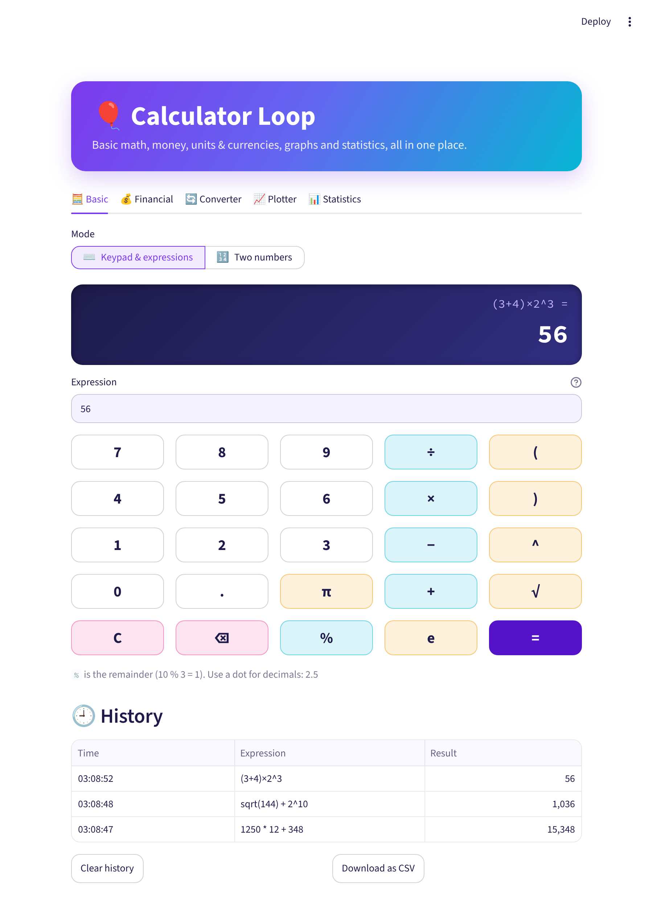
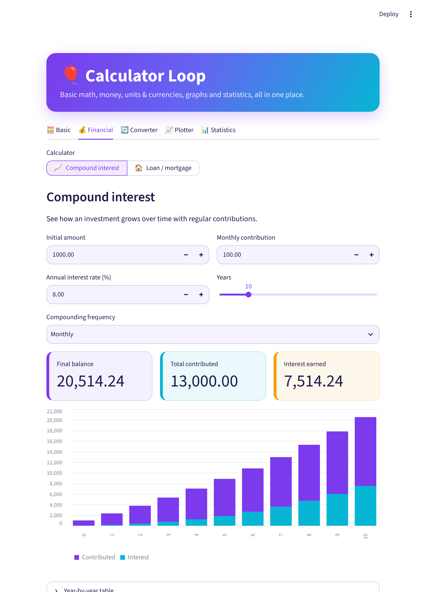
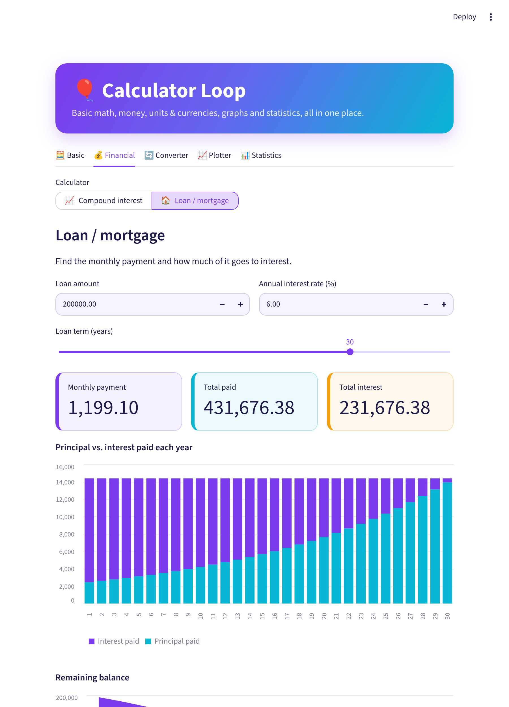
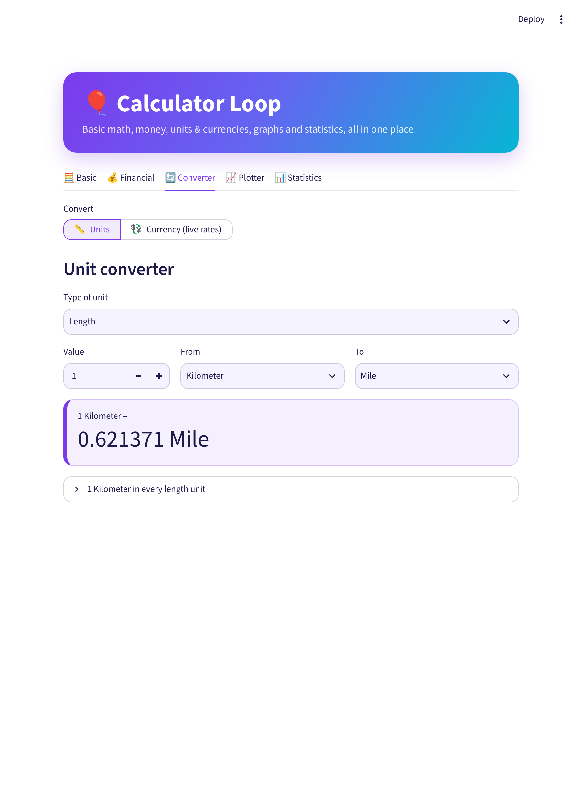
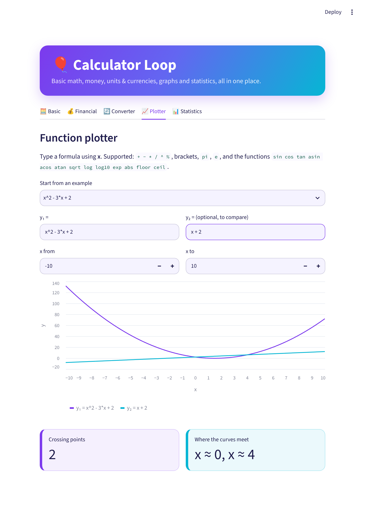
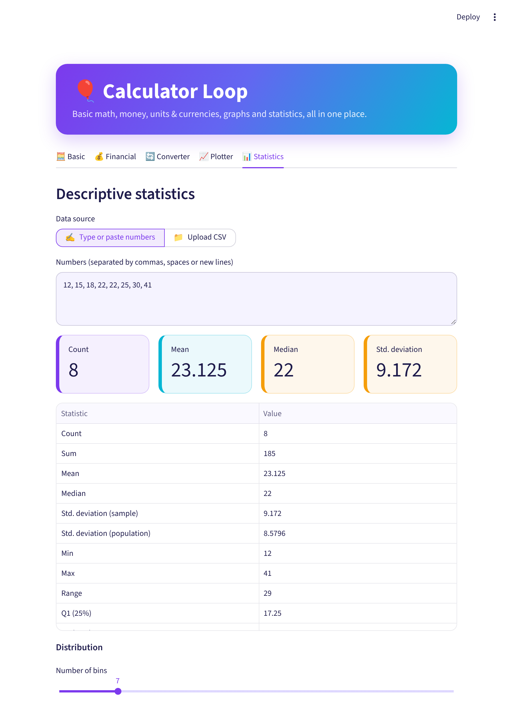

# 🎈 Calculator Loop – Streamlit Application

[](https://github.com/apcondessa/Calculator/actions/workflows/ci.yml)

[](https://calculator-loomping.streamlit.app/)

An interactive **multi-tool calculator** built with **Python** and **Streamlit**: basic math with a calculation history, financial planning, unit conversion, a function plotter and quick descriptive statistics, all in one web app.

**👉 Try it live: <https://calculator-loomping.streamlit.app/>**

The project started as a terminal calculator and grew into a small, tested web application with the calculation logic kept separate from the user interface.



---

## ✨ Features

The app is organized into five colourful tabs and supports light and dark mode.

### 🧮 Basic
- **Keypad calculator:** click colourful keys or type expressions such as `(3 + 4) × 2^3` or `sqrt(144) + 2^10`, then press `=` or Enter
- A calculator-style display; keep calculating from the last answer
- **Two-number mode:** pick an operation (+, −, ×, ÷, power, modulo, percentage, square root)
- Clear error messages (division by zero, square root of a negative number, decimal comma instead of dot…)
- **Calculation history** with *Clear history* and *Download as CSV*

### 💰 Financial
- **Compound interest:** initial amount, monthly contributions, annual rate, years and compounding frequency, with a stacked chart of contributions vs. interest
- **Loan / mortgage:** monthly payment, total paid and total interest, with a principal-vs-interest chart and the remaining balance over time
- Year-by-year tables for both

### 🔄 Converter
- **Units:** length, weight, volume, speed, data size and temperature, with the value shown in every unit of the chosen type
- **💱 Currency (live rates):** convert between 30+ currencies (BRL, USD, EUR, GBP…) using the European Central Bank reference rates from [Frankfurter](https://frankfurter.dev), with a swap button and a rate-history chart (1 month to 5 years)

### 📈 Plotter
- Type a formula of `x` (e.g. `x^2 - 3*x + 2` or `sin(x) * exp(-x/5)`) and see its graph over any range
- **Compare two formulas** on the same chart and see where the curves cross
- Supports `+ - * / ^ %`, brackets, `pi`, `e` and common math functions (`sin`, `cos`, `sqrt`, `log`, `exp`, `abs`…)
- Formulas are parsed safely: only math is allowed, so no arbitrary code can run

### 📊 Statistics
- Type/paste a list of numbers or upload a CSV and pick a numeric column
- Count, sum, mean, median, standard deviation, min, max, range, quartiles and IQR
- Histogram with an adjustable number of bins

---

## 📸 Screenshots

| Financial – compound interest | Financial – loan |
| --- | --- |
|  |  |

| Converter | Plotter | Statistics |
| --- | --- | --- |
|  |  |  |

---

## 🧰 Tech Stack

- **Python 3**
- **Streamlit** – web interface, theme and charts
- **pandas** – tables, CSV handling and statistics
- **Altair** – currency history chart
- **requests** + **Frankfurter API** – live exchange rates (no API key needed)
- **pytest** – automated tests
- **ruff** – linting and formatting
- **GitHub Actions** – runs the linter and tests on every push and pull request

### Project structure

```
├── streamlit_app.py          # User interface (tabs, inputs, charts)
├── calculator.py             # Calculation logic, independent from the UI
├── currency.py               # Live exchange rates (Frankfurter API)
├── .streamlit/config.toml    # Colour theme (light and dark)
├── tests/
│   ├── test_calculator.py    # Unit tests for the calculation logic
│   ├── test_currency.py      # Currency tests with simulated API responses
│   └── test_app.py           # Runs the app headlessly and checks each tab
├── docs/screenshots/         # Images used in this README
├── requirements.txt          # Packages needed to run the app
├── requirements-dev.txt      # Extra packages for testing and linting
└── .github/workflows/ci.yml  # Continuous integration
```

---

## 📦 Requirements

- Python 3.10 or higher
- pip (Python package manager)

---

## 🚀 How to Run

1. **Clone the repository**

   ```bash
   git clone https://github.com/apcondessa/Calculator.git
   cd Calculator
   ```

2. **(Optional) Create and activate a virtual environment**

   ```bash
   python -m venv .venv
   source .venv/bin/activate   # On Windows: .venv\Scripts\activate
   ```

3. **Install the dependencies**

   ```bash
   pip install -r requirements.txt
   ```

4. **Start the app**

   ```bash
   streamlit run streamlit_app.py
   ```

5. Open the URL shown in the terminal (usually <http://localhost:8501>) in your browser.

---

## 🧪 Running the Tests

Install the development dependencies, then run the linter and the tests:

```bash
pip install -r requirements-dev.txt
ruff check .
pytest
```

The same checks run automatically on GitHub for every push and pull request (see the **CI** badge at the top).

---

## ☁️ Deploying to Streamlit Community Cloud

The app can be published for free so anyone can use it in the browser:

1. Go to <https://share.streamlit.io> and sign in with GitHub.
2. Click **Create app** → **Deploy a public app from GitHub**.
3. Choose the repository `apcondessa/Calculator`, branch `main`, and main file `streamlit_app.py`.
4. Click **Deploy**. Every new push to `main` updates the live app automatically.

The live version of this project is at <https://calculator-loomping.streamlit.app/>.

---

## 📄 License

This project is licensed under the [Apache License 2.0](LICENSE).
